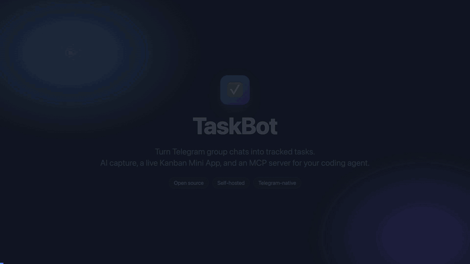
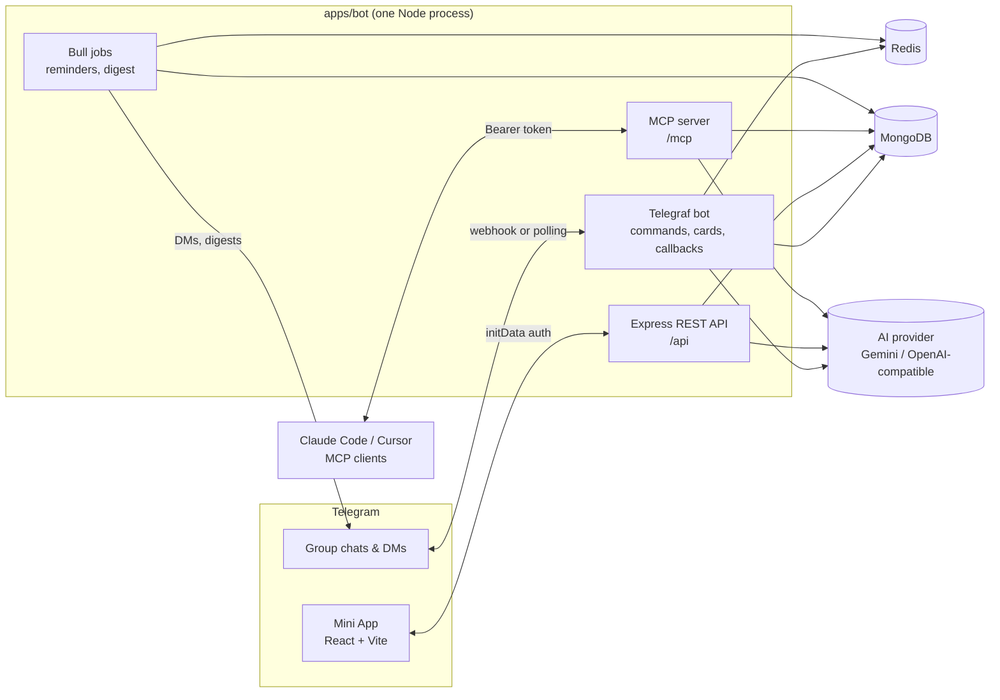

<div align="center">

# TaskBot

**Turn Telegram group chat messages into tracked tasks, with AI, a Kanban board Mini App, and an MCP server for your coding agent.**

[](LICENSE)
[](https://nodejs.org)
[](https://pnpm.io)
[](https://www.typescriptlang.org)
[](https://core.telegram.org/bots/api)
[](#contributing)

[Features](#features) · [Demo](#demo) · [Get started](#get-started) · [MCP](#connect-claude-code--cursor-mcp) · [Docs](#documentation)

</div>

---

## Demo

<p align="center">
  
</p>

<p align="center">Full video: <a href="docs/assets/demo.mp4">docs/assets/demo.mp4</a></p>

## Why TaskBot

Small teams already make their decisions in Telegram groups: "can you fix the login bug by Friday?", "I'll take the
release notes". Those messages scroll away and nobody tracks them.

TaskBot sits in the group and turns those messages into real tasks. It picks out the title, type, assignee and due
date with AI, posts a task card you can act on right in the chat, and keeps a Kanban/list board in a Telegram Mini App
in sync with it. Each Telegram group is its own workspace. Nobody needs a new account: Telegram is the login.

## Features

**In the chat**
- `/new` turns text, a replied-to message, a whole thread (`/new all`) or the last N messages (`/new 10`) into one or more tasks
- Interactive task cards: move to the next status, assign, and change status, type or priority from the card
- `/sub` adds subtasks to a task; `/list`, `/mytasks` and `/done` cover quick daily use
- Undo for tasks created by mistake (10 minutes)
- Forum-topic aware: task events go to a dedicated "Task events" topic (or one you choose with `/settopic`)
- Interactive `/help` guide with topic pages

**AI assistant**
- Extracts tasks from free text, detecting type, assignee and due date, and can split one message into several tasks
- `/ai` and `/update` take plain-language requests: reassign, change status or priority, set due dates, explain a task, group tasks into epics, split a task into subtasks, or answer "what's left for me?"
- Understands Vietnamese and English and replies in the user's language
- Pluggable providers: Gemini, OpenAI, or any OpenAI-compatible endpoint (OpenRouter, Groq, vLLM, Ollama, ...)
- Works without an AI key too: `/new` falls back to creating a basic task

**Mini App board**
- Kanban board (drag-and-drop between statuses) and a paginated, sortable list view
- Group by status or by assignee; filter by type, assignee or "just mine"
- Task detail page with editable fields, subtasks and progress, source chat messages and an activity timeline
- Epics page with progress, colors, close/reopen
- "Ask AI" chat panel, the same assistant as `/ai`
- Runs inside Telegram (fullscreen supported) or in a normal browser via the Telegram Login Widget
- Two-way sync: changes in the app update the task card in the group, and the other way round

**Integrations (MCP)**
- Remote MCP server at `/mcp` so Claude Code, Cursor and other MCP clients can list, create and update tasks and epics
- `ask_taskbot` lets your agent talk to TaskBot's AI in plain words; structured tools are there for precise edits
- Per-user access tokens, scoped to one group or all your groups, which you manage from the Mini App
- Agent changes show up in the group as `(via Claude Code)` / `(via Cursor)`

**Automation**
- DM notifications when you're assigned or your task changes status
- Due-date reminders by DM (the day before the task is due, from 9:00 group time)
- Daily group digest at 9:00 in the group's timezone

## How it works



- **Multi-tenancy:** every query is scoped by `groupId` (one Telegram group = one workspace).
- **Mini App auth:** Telegram `initData` is validated server-side with `@telegram-apps/init-data-node` (HMAC against the bot token). There is no separate auth system.
- **Bidirectional sync:** task changes made in the Mini App edit the task card in the group chat, and the other way round.
- **Scheduled jobs (Bull):** both jobs run hourly and decide per group, in the group's timezone, whether to send.

## Command highlights

| Command | What it does |
|---------|--------------|
| `/new Fix login on iOS @an` | AI turns text into one or more tasks (type, assignee, due date) |
| reply `/new` · `/new all` · `/new 10` | Turn a message, a thread or the last N messages into tasks |
| `/sub 12 Write tests @an` | Add a subtask to #12 |
| `/ai move #12 to review, priority high` | Ask or change anything in plain words (Vietnamese or English) |
| `/update #12 due Friday, assign to @an` | Change one task with AI |
| `/list bug` · `/mytasks` · `/done #12` | Everyday task management |
| `/mcp` | Connect Claude Code / Cursor |

Full reference: [docs/commands.md](docs/commands.md).

## Connect Claude Code / Cursor (MCP)

The bot serves a remote MCP server at `/mcp`. Send `/mcp` to the bot in a private chat to get a token, then:

```bash
claude mcp add --transport http taskbot <url> --header "Authorization: Bearer <token>"
```

Now ask your agent things like *"create a task to fix login for @an, due Friday"* or *"what's overdue in Team Alpha?"*.
Cursor setup, token scopes, the tool reference and limits are in [docs/mcp.md](docs/mcp.md).

## Tech stack

| Area | Technology |
|------|------------|
| Bot | [Telegraf](https://telegraf.js.org) 4, Telegram Bot API (webhook or long polling) |
| API | Express 5, Zod validation |
| Data | MongoDB (Mongoose), Redis |
| Jobs | Bull (Redis-backed, cron) |
| AI | Gemini (`@google/generative-ai`), OpenAI / OpenAI-compatible, Fuse |
| MCP | `@modelcontextprotocol/sdk`, Streamable HTTP (stateless JSON) |
| Mini App | React 19, Vite, Tailwind CSS v4, TanStack Router + Query, React Query Kit, `@telegram-apps/sdk-react`, dnd-kit |
| Monorepo | pnpm workspaces, Turborepo, shared types in `@tbot/shared` |
| Tooling | TypeScript 5, Jest, Prettier, Husky, lint-staged, Commitizen |

## Get started

You need Node.js ≥ 20, pnpm 10, Docker (for MongoDB and Redis) and a bot token from [@BotFather](https://t.me/BotFather).

```bash
git clone https://github.com/tun2g/taskbot.git && cd taskbot
pnpm install
docker compose -f docker-compose.dev.yml up -d   # MongoDB + Redis
cp apps/bot/.env.example apps/bot/.env           # set BOT_TOKEN
cp apps/web/.env.example apps/web/.env
pnpm dev                                         # bot on :3000, Mini App on :5173
```

Then see the guides below, starting with [Getting started](docs/getting-started.md) and [Configuration](docs/configuration.md).

## Documentation

| Guide | Contents |
|-------|----------|
| [Getting started](docs/getting-started.md) | Prerequisites, running locally, env files |
| [Configuration](docs/configuration.md) | Environment variables, BotFather setup, group setup tips |
| [Bot commands](docs/commands.md) | Full command reference, `/ai` examples, task model |
| [Mini App in Telegram](docs/telegram-mini-app.md) | HTTPS tunnels, Telegram launch-point cheat sheet |
| [MCP server](docs/mcp.md) | Claude Code / Cursor setup, tokens, tools, self-hosting |
| [Deployment](docs/deployment.md) | Docker Compose, Mini App image, prebuilt GHCR images |
| [Development](docs/development.md) | Scripts, tests, project structure, known issues |

## Contributing

Contributions are welcome. Bug reports, feature ideas and pull requests all help.

1. Fork the repo and create a branch from `main`.
2. Make your change, and add or update tests in `apps/bot/src/__tests__` where it makes sense.
3. Make sure `pnpm check-types` and `cd apps/bot && pnpm test` pass.
4. Commit using [Conventional Commits](https://www.conventionalcommits.org) (`feat:`, `fix:`, `docs:`, ...). Run `pnpm commit` for a guided prompt.
5. Open a pull request describing what changed and why.

## License

[MIT](LICENSE)

## Acknowledgements

Built with [Telegraf](https://telegraf.js.org), [Telegram Mini Apps SDK](https://docs.telegram-mini-apps.com),
[TanStack](https://tanstack.com), [Model Context Protocol](https://modelcontextprotocol.io) and
[Turborepo](https://turbo.build).
